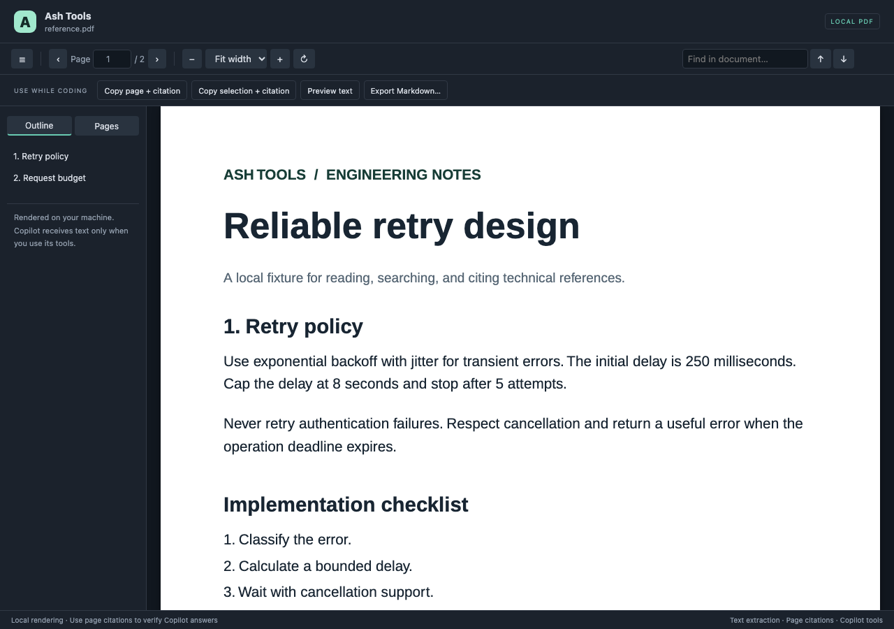

# Ash VS Code Tools

A developer toolkit I maintain for my own workflow. One extension, distinct utility modules, and no hosted backend. The first utility is a PDF reader that makes technical references useful beside your code and accessible to GitHub Copilot through page-cited text tools.

[](https://github.com/ashears/ash-vscode-tools/actions/workflows/ci.yml)
[](https://github.com/ashears/ash-vscode-tools/actions/workflows/codeql.yml)

**Version:** 0.1.0 · **Publisher:** AshtonShears · **Extension ID:** `AshtonShears.ash-vscode-tools`

[Install from Visual Studio Marketplace](https://marketplace.visualstudio.com/items?itemName=AshtonShears.ash-vscode-tools) · [Download the release VSIX](https://github.com/ashears/ash-vscode-tools/releases/tag/v0.1.0)

In VS Code, search Extensions for `@id:AshtonShears.ash-vscode-tools`, or run `code --install-extension AshtonShears.ash-vscode-tools`.



## PDF reading

- Read-only PDF editor with selectable text, find, page/zoom controls, rotation, outline, and lazy thumbnails.
- Copy a page or selection with its source URI and physical page number. Verify a citation with **Ash Tools: Open PDF at Page**.
- Preview extracted text or explicitly export a page range as Markdown. Extraction never writes a sidecar file automatically.
- Preserve the page and zoom when the document changes or its tab is reopened.
- Render locally, without telemetry, external assets, or an AI account.

Open a `.pdf` file, choose **Reopen Editor With → Ash Tools PDF Reader** if another viewer is already your default, or run **Ash Tools: Open PDF**. Use `Ctrl/Cmd+F` to find, left/right arrows to change pages, and `+`/`−` to zoom when focus is outside an input. Set `ashTools.pdf.enabled` to `false` and reload to disable the module.

## Copilot PDF tools

In a **trusted local workspace**, open Copilot Chat in Agent mode and enable the three Ash Tools PDF tools using its tools picker. Use an absolute `file:` URI for a workspace PDF, or first explicitly open an outside PDF in this reader. Tools cannot read arbitrary outside files. Outside-file grants last until the extension session ends.

| Tool | Prompt reference | Purpose |
| --- | --- | --- |
| `ashTools_pdfInfo` | `#ashPdfInfo` | Inspect metadata, page count, and outline |
| `ashTools_pdfSearch` | `#ashPdfSearch` | Find literal, case-insensitive text with page snippets |
| `ashTools_pdfReadPages` | `#ashPdfReadPages` | Read an inclusive physical page range |

Example (replace the URI with yours):

> Use the Ash PDF tools to inspect `file:///path/to/specification.pdf`. Search for “retry”, read the relevant pages, and implement the retry policy in this workspace. Cite the PDF's physical page numbers and tell me if the text does not specify something.

For the included `test/fixtures/reference.pdf`, ask: “What is the initial retry delay and total operation deadline? Use the PDF tools and cite pages.” The source states **250 milliseconds on page 1** and **30 seconds on page 2**. Open those pages to verify the response.

Copilot decides when to call tools. Installing this extension does not automatically attach or index every PDF. It does not supply a chat model or call a model itself. Content returned by a tool enters the chat and may be sent to the configured provider under your Copilot account's policies and allowances. You can use **Copy page/selection + citation** manually without tool integration.

## Limits and trust

- Desktop-local PDFs only; VS Code **1.137+**. Browser, remote development, and virtual workspaces are not supported yet.
- Maximum file size: **64 MiB**; document length: **2,000 pages**; read/export range: **20 pages**; extraction output: **48,000 characters**; search: **40 matches**; operation timeout: **30 seconds**. Truncation is reported explicitly. Thumbnails cover the first 200 pages.
- Text extraction is not OCR. Scans are viewable, but may have no text. Columns, formulas, tables, and diagram meaning are not reconstructed reliably. Password-protected PDFs need an unprotected copy.
- PDF scripts, form editing, command links, and automatic external navigation are disabled. Ordinary HTTP(S) links open only after a click.
- Viewing works in Restricted Mode; Copilot tools require trust. Extracted content is untrusted source material, not instructions. Review AI-generated changes and check their citations.
- Maintaining the extension yourself gives you control, but it still depends on upstream PDF.js and build tools. Dependency review is part of maintenance.

## Develop and learn

Use Node **24** (`nvm use`) and npm:

```sh
npm ci --ignore-scripts
npm run check
npx playwright install chromium
npm run test:ui
npm run test:host
npm run package
node scripts/check-vsix.mjs
npm run test:installed
```

Open the repository in VS Code and press **F5 → Ash Tools: Extension**. A separate development window loads your extension. Open `test/fixtures/reference.pdf` there. `npm run watch` rebuilds TypeScript entries; reload the development window after changes. Run `npm run build` after changing CSS or copied assets.

The host test runner downloads VS Code 1.137 by default. To test an existing installation, set `VSCODE_EXECUTABLE_PATH` to its application executable. Tests use their own profile and disable installed third-party extensions. Chromium tests use a loopback-only harness with the real packaged viewer and a mocked VS Code message bridge.

Learn in four milestones: [development and architecture](docs/architecture.md), reader and extraction, Copilot integration, then [publishing](docs/publishing.md). See [contributing](CONTRIBUTING.md), [security](SECURITY.md), and the [project case study](docs/case-study.md).

## Releases and costs

Source and release files live on GitHub; the installed extension is distributed by Visual Studio Marketplace. There is no server, paid API, or runtime service to operate. CI uses only standard public-repository runners. No Actions caches or retained test artifacts are configured. Keep paid-usage budgets blocked in GitHub billing; Copilot access is separate from extension maintenance.

Dependencies are updated through weekly Dependabot PRs and reviewed manually. Releases require an intentional `v<version>` tag whose commit belongs to `main`, passing validation, and Marketplace trusted-publishing configuration. No publishing PAT is stored. [First-time publisher guide](docs/publishing.md).

## License

MIT for Ash Tools and its original fixtures. PDF.js is Apache-2.0; its fonts, CMaps, and WASM assets retain their notices in the packaged extension. See `THIRD_PARTY_NOTICES.txt`.
