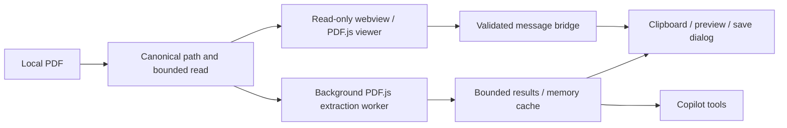

# How the extension works

## Milestone 1: scaffold and debugging

`package.json` is VS Code's public interface: commands appear in the palette, `customEditors` associates PDFs with the reader, settings control modules, and `languageModelTools` describes tool inputs to Copilot. Command contributions activate the extension automatically; editor and tool activation events cover their respective entry points.

`activate(context)` checks the module setting, dynamically imports the PDF module, and gives ownership to `context.subscriptions`. A utility implements `UtilityModule` with an ID and `dispose()`. VS Code calls disposal at extension shutdown; each module releases listeners, views, workers, and tool registrations. esbuild bundles host code, but the PDF.js parsing assets remain separate and are not evaluated until a PDF operation is requested.

Press F5 to start the extension development host. Its build task generates local source maps for TypeScript breakpoints. The normal and packaged builds deliberately omit source maps. Inspect the Extension Host output for runtime errors. Rebuild and reload that window after changes. See commands and scripts in the README.

## Milestone 2: viewer and extraction

The custom editor owns PDF bytes and watches the source for changes. Its webview receives only the selected document bytes and view state, not filesystem APIs. PDF.js's viewer supplies canvas rendering, selection, search, and internal navigation; Ash Tools provides the surrounding toolbar, outline, lazy thumbnails, and context commands. Host messages are handled through a small allowlist with per-action input checks. Document changes invalidate extraction results and reload the viewer while retaining position.

Text operations share `PdfService`. Each uncached request reads a bounded snapshot and launches a worker using the PDF.js compatibility build. Only one request parses at a time. Cancellation terminates the worker; a deadline and heap target bound failures. Results use an 8 MiB LRU cache keyed by canonical path, file identity/change signature, and operation. The cache never bypasses current authorization or trust checks.

Native canvas libraries are not shipped or required for text extraction. PDF.js may probe for them and emit rendering-only startup warnings in its worker; those stdout messages are drained. All actual PDF rendering happens in the browser webview.

## Milestone 3: Copilot tools

Each tool declares a JSON schema and also validates inputs at runtime. The same service backs UI commands and tools, with additional tool access checks: trusted workspace, workspace membership after symlink resolution, or a session grant created when the user opens a PDF in the custom editor.

`pdfInfo` returns metadata and an outline capped to 200 entries/eight levels. `pdfSearch` searches literal text page by page and returns up to 40 snippets. `pdfReadPages` reads up to 20 pages with a 48,000-character total budget. Per-page extraction caps at 240,000 characters. Responses identify physical pages, truncation, empty text, and untrusted content. Tool invocation displays file/range information and a provider-disclosure confirmation through VS Code's tool API.

## Milestone 4: distribution

The build copies PDF.js modules, worker, viewer CSS, fonts, CMaps, WASM files, and notices. `vsce` bundles only allowlisted runtime/docs/media files. `check-vsix.mjs` inspects the ZIP directory and fails if development folders leak. The tag workflow verifies the publisher, version, clean checkout, and main ancestry before validation and publication. GitHub release assets and Marketplace receive the same packaged VSIX. No runtime hosting exists.
